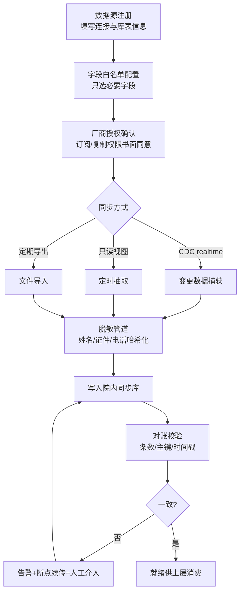
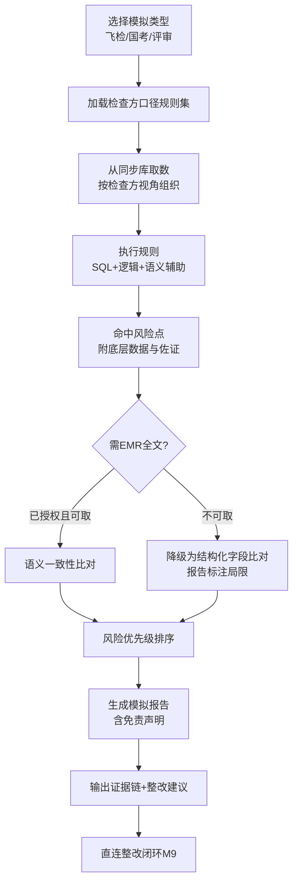

# 医院运营数据治理与决策支持平台 · 功能概要设计

版本：v1.0｜日期：2026-11-18｜状态：待评审
输入基线：《医院运营数据治理与决策支持平台·产品定位 v0.4》（终审通过）
用途：研发排期与实现｜颗粒度：功能概要级（功能树 + 流程图 + 功能定义表）
阅读对象：产品、研发、测试、实施、售前

---

## 0. 文档说明

### 0.1 本设计回答什么

回答三个问题：**系统要做哪些功能、每个功能做什么、功能之间怎么依赖**。不回答字段级细节（留给详细设计/PRD）、不回答界面视觉（留给交互设计）、不回答具体算法实现（留给技术设计）。

### 0.2 从定位继承的硬约束（不可协商）

| # | 约束 | 对设计的强制要求 |
|---|---|---|
| C1 | **不动生产库、不写回生产** | 一期所有读操作走院内只读同步库；唯一写回生产是三期工作站提醒，且只写提醒消息不写病历 |
| C2 | **数据不出院** | 公立版同步库与平台均在院内；民营版原始数据院内、仅脱敏结果与特征上云 |
| C3 | **不做 HRP / 不做分组器 / 不做通用 BI** | 不设计记账、全成本核算、DRG 分组计算、自由报表配置；结余分析只读分组结果并核查 |
| C4 | **检查组视角模拟是唯一尖刀** | M6 内嵌于各模块、不单独售卖；任何一期交付都必须包含它的一次输出 |
| C5 | **模块授权可开关** | 所有决策模块受 License 控制，未授权模块功能入口不可见、规则包不下发 |
| C6 | **不承诺"保证通过"** | 所有输出标注为"辅助自查/模拟"，报告页脚与导出物固定免责声明 |

### 0.3 设计原则

1. **一条数据链贯穿**：接入→同步→治理→核验→规则→模拟→整改→归档，所有模块消费同一条链的产物，禁止模块自建数据通道。
2. **能力可降级**：每个依赖外部系统的功能都必须定义"拿不到依赖时的降级形态"，避免实施现场卡死。
3. **先尖刀后底座**：一期以最小可用集跑通"模拟检查报告"闭环，底座能力随报告质量需求逐步加深，不追求一次建全。
4. **分期即承诺边界**：P2b/P3 功能在设计上预留接口，但不进一期合同；设计文档与售卖红线（定位 v0.4 §4.5.2）保持一致。

### 0.4 功能编号规则

```
M<模块号>-<功能序号>      如 M1-02 = 数据接入与同步模块第2个功能
模块前缀：M1..M17
分期标记：P1（一期）/ P2a（二期上）/ P2b（二期下）/ P3（三期）
```

---

# 第一部分 功能架构

## 1. 总体分层架构

```
┌──────────────────────────────────────────────────────────────┐
│ L5 交互与输出层                                                │
│ 模拟报告 | 指标看板 | 院长驾驶舱 | 整改工单 | 证据包 | 问答助手 │
├──────────────────────────────────────────────────────────────┤
│ L4 决策应用层（License 开关）                                  │
│ M6检查视角模拟(尖刀·内嵌) M7检查风险 M8国考沙盘 M9整改闭环     │
│ M10结余分析 M11科室画像 M12驾驶舱 M13数智评级 M14 AI增强       │
│ M15个人画像 M16工作站嵌入                                      │
├──────────────────────────────────────────────────────────────┤
│ L3 能力引擎层                                                  │
│ M5规则引擎(SQL/逻辑/语义) | 指标口径引擎 | 风险优先级引擎       │
├──────────────────────────────────────────────────────────────┤
│ L2 治理底座层（必选）                                          │
│ M2术语编码归一化 | M3数据质量体检 | M4同一性核验中枢 | 口径管理 │
├──────────────────────────────────────────────────────────────┤
│ L1 接入与同步层                                                │
│ M1数据源注册/字段白名单/CDC增量同步/脱敏/对账/链路监控         │
├──────────────────────────────────────────────────────────────┤
│ L0 院内数据源（生产域，厂商运维，不直连）                      │
│ HIS | EMR | 病案 | 医保结算 | 收费医嘱 | LIS/PACS | ODR | HRP  │
└──────────────────────────────────────────────────────────────┘
   ↕ 贯穿层 M17 平台支撑：授权中心 | 审计中心 | 用户角色 | 任务调度 | 配置管理
```

**关键设计**：L1 与 L0 之间是唯一的系统边界——通过 CDC/只读视图/定期导出把变更数据订阅到院内同步库，L2 及以上只访问同步库，永不触碰生产域。

## 2. 模块总览（17 个模块）

| 模块 | 名称 | 分期 | 定位角色 | 是否必选 |
|---|---|---|---|---|
| M1 | 运营数据接入与同步 | P1 | 数据入口 | 必选（底座） |
| M2 | 术语与编码归一化 | P1 | 底座能力 | 必选（底座） |
| M3 | 数据质量体检 | P1 | 底座能力 | 必选（底座） |
| M4 | 统一口径与同一性核验中枢 | P1 | 核心壁垒 | 必选（底座） |
| M5 | 规则引擎 | P1 | 能力引擎 | 必选（底座） |
| M6 | 检查组视角模拟引擎 | P1 | **尖刀，内嵌** | 随模块，不单独售卖 |
| M7 | 检查风险决策 | P1 | 打进门 | 按模块授权 |
| M8 | 国考指标沙盘 | P1 | 打进门 | 按模块授权 |
| M9 | 整改闭环 | P1 | 打进门 | 建议捆绑 |
| M10 | DRG/DIP 结余分析 | P2a | 留住院长 | 按模块授权 |
| M11 | 科室经营画像 | P2a | 留住院长 | 按模块授权 |
| M12 | 院长驾驶舱 | P2a | 整合层 | 随模块交付 |
| M13 | 数智评级规则库 | P2b | 等政策 | 预授权+发布后激活 |
| M14 | AI 增强包 | P2b | 等技术 | 高级授权包 |
| M15 | 医生个人合规画像 | P3 | 新战场 | 待立项 |
| M16 | 医生工作站嵌入 | P3 | 新战场 | 待生态成熟 |
| M17 | 平台支撑 | P1 起 | 贯穿 | 必选 |

## 3. 四期功能全景（研发口径）

| 分期 | 模块 | 本期交付范围 | 前置条件 | 验收关卡 |
|---|---|---|---|---|
| **P1 一期** | M1-M9（除M10-M16）+ M17 | 同步库打通 HIS/病案/收费；规则引擎跑通不依赖 EMR 全文的规则；模拟检查报告、国考沙盘、整改闭环三件套 | 9.3 接口尽调通过；院内同步库资源落实 | M1：脱敏数据跑出被目标医院认可的《模拟飞行检查报告》 |
| **P2a 二期上** | M10-M12 | 结余分析 → 科室画像 → 驾驶舱（严格按此顺序） | **阻塞**：院内 DRG/DIP 分组系统结果 + 成本数据（到病种级）；无此二者降级为科室级粗算 | 结余口径与医院核算结果偏差在约定阈值内 |
| **P2b 二期下** | M13、M14 | 数智评级规则库；AI 增强包 | M13 等标准正式发布（预授权）；M14 须过误报率评测 | M14 语义质控误报率低于设定阈值方可开放 |
| **P3 三期** | M15、M16 | 个人合规画像；医生工作站嵌入 | M15 验证付费意愿与人事合规边界；M16 依赖厂商配合 | 付费意愿验证通过 / 厂商接口协议签署 |

## 4. 核心业务流程

### 4.1 端到端主流程


### 4.2 数据同步流程（M1）



### 4.3 检查视角模拟流程（M6，尖刀）



### 4.4 整改闭环流程（M9）

```
问题登记（来源：模拟报告/预警/人工）→ 自动派单（按科室/责任人）
→ 整改执行（上传佐证材料）→ 复核（规则自动核验 + 人工确认）
→ 归档（形成证据链）→ 效果回写（风险点状态更新、纳入下次模拟基线）
```

---

# 第二部分 功能定义表

> 阅读说明：每个功能点给出 **输入 / 处理 / 输出 / 规则要点 / 权限 / 依赖 / 验收口径** 七要素。"依赖"列标注阻塞级依赖与降级形态，是研发排期与售前承诺的共同依据。

## M1 运营数据接入与同步（P1·必选底座）

| 编号 | 功能 | 输入 | 处理逻辑 | 输出 | 规则要点 | 权限 | 依赖 | 验收口径 |
|---|---|---|---|---|---|---|---|---|
| M1-01 | 数据源注册 | 连接信息、库表清单、厂商授权文件 | 登记数据源元数据，标注接入方式（CDC/视图/导出）与就绪度 | 数据源台账 | 未上传授权文件不得启用同步 | 实施管理员 | 厂商书面授权（9.3） | 每个源可追溯授权状态 |
| M1-02 | 字段白名单配置 | 源表字段清单 | 按最小必要原则勾选同步字段，生成同步映射 | 字段映射表 | 默认全不选，逐字段勾选；含 PHI 字段强制标记 | 实施管理员 | M1-01 | 同步库字段数与白名单一致，无多余字段 |
| M1-03 | CDC 增量同步 | 源库变更日志（binlog/OGG） | 捕获增改删变更，按映射写入同步库 | 同步库增量数据 | 只订阅不写回；删除操作做逻辑标记保留历史 | 系统 | M1-02、厂商订阅授权 | 变更在 5 分钟内同步到位 |
| M1-04 | 只读视图/导出接入 | 视图或导出文件 | 定时抽取（默认日级），按映射落库 | 同步库数据 | 用于无法开通 CDC 的源；频率可配 | 系统 | M1-02 | 按配置周期稳定落库 |
| M1-05 | 脱敏管道 | 同步中的原始字段 | 姓名/证件/电话等哈希化或掩码，规则可配 | 脱敏后数据 | 脱敏在落库前完成，同步库不含明文 PHI | 系统 | M1-02 | 抽检同步库无明文身份信息 |
| M1-06 | 同步对账 | 源与同步库双侧计数 | 按主键、条数、时间戳比对，输出差异 | 对账报告 | 日级全量对账 + 增量流水对账 | 实施管理员 | M1-03/04 | 差异率在阈值内，超限告警 |
| M1-07 | 链路监控与断点续传 | 同步任务运行态 | 监控延迟/中断，自动重试并记录断点 | 告警、续传日志 | 中断不得丢数据；恢复后从断点续传 | 运维 | M1-03/04 | 模拟中断后能从断点恢复且无重复 |

## M2 术语与编码归一化（P1·必选底座）

| 编号 | 功能 | 输入 | 处理逻辑 | 输出 | 规则要点 | 权限 | 依赖 | 验收口径 |
|---|---|---|---|---|---|---|---|---|
| M2-01 | 编码体系映射 | ICD-10、ICD-9-CM3、医保目录 | 建立多编码体系对照关系，支持版本 | 映射字典 | 版本化，历史版本可回溯 | 规则运营 | M1 | 抽样编码映射准确率达标 |
| M2-02 | 术语归一 | 各源自由文本诊断/术式 | 归一化到标准术语，标记未匹配项 | 标准术语 + 待确认队列 | 未匹配项进人工队列，不静默丢弃 | 规则运营 | M2-01 | 未匹配项有处理闭环 |
| M2-03 | 映射版本管理 | 新版本目录文件 | 版本比对、灰度发布、回滚 | 版本记录 | 规则库随版本联动更新 | 规则运营 | M2-01 | 可回滚到任一历史版本 |

## M3 数据质量体检（P1·必选底座）

| 编号 | 功能 | 输入 | 处理逻辑 | 输出 | 规则要点 | 权限 | 依赖 | 验收口径 |
|---|---|---|---|---|---|---|---|---|
| M3-01 | 五维度质量规则 | 同步库数据 | 按唯一性/完整性/合规性/同一性/时效性执行校验 | 问题明细 | 规则可配阈值；对应 80% 否决线 | 规则运营 | M1、M2 | 五维度均有可解释的问题定位 |
| M3-02 | 数据质量分 | 问题明细 | 按维度加权计算质量分 | 质量分、达标率 | 口径与官方 80% 否决线一致 | 全角色只读 | M3-01 | 计算口径可追溯到规则 |
| M3-03 | 否决线预警 | 达标率 | 低于 80% 触发预警 | 预警通知 | 预警到人（信息科/病案室） | 全角色只读 | M3-02 | 阈值触发准确无漏报 |
| M3-04 | 质量报告导出 | 质量分、问题明细 | 生成分层报告（院级/科室级） | 质量体检报告 | 报告为辅助自查，含免责声明 | 授权用户 | M3-02 | 可作为售前 Demo 物料 |

## M4 统一口径与同一性核验中枢（P1·核心壁垒）

| 编号 | 功能 | 输入 | 处理逻辑 | 输出 | 规则要点 | 权限 | 依赖 | 验收口径 |
|---|---|---|---|---|---|---|---|---|
| M4-01 | 多源交叉核验 | 病案首页/医保结算/EMR/医嘱收费 | 同一患者就诊按主键对齐，比对关键字段一致性 | 差异明细 | 同一性重灾区优先（诊断、手术、费用） | 规则运营 | M1、M2 | 差异定位到具体字段与来源 |
| M4-02 | 指标口径登记 | 指标定义、取数逻辑 | 登记每个指标的取数口径与底层数据元 | 口径字典 | 口径需绑定数据元，禁止空定义 | 规则运营 | M2 | 国考指标口径可追溯率 ≥90% |
| M4-03 | 口径变更留痕 | 口径修改操作 | 记录变更人/时间/前后值，支持审计 | 变更日志 | 变更不改历史计算结果 | 规则运营 | M4-02 | 任一变更可审计回放 |
| M4-04 | 政策条文规则化 | 政策文件 | 人工/辅助将条文翻译为可执行规则草稿 | 规则草稿 | 发布需人工审核，禁止自动生效 | 规则运营 | M5 | 每条规则可溯源到政策条款 |

## M5 规则引擎（P1·必选底座）

| 编号 | 功能 | 输入 | 处理逻辑 | 输出 | 规则要点 | 权限 | 依赖 | 验收口径 |
|---|---|---|---|---|---|---|---|---|
| M5-01 | SQL 规则执行 | 结构化数据 + SQL 规则 | 调度执行，产出命中记录 | 命中集 | 规则分包，按授权加载 | 系统 | M1 | 规则可解释、可复核 |
| M5-02 | 逻辑规则执行 | 多源字段 + 逻辑表达式 | 执行组合逻辑（如分解住院判定） | 命中集 | 阈值可配，命中附证据 | 系统 | M1、M4 | 命中结果可复现 |
| M5-03 | 语义规则（辅助） | EMR 文本 + 编码 | 语义一致性比对，输出提示 | 提示集（人工复核） | **不作独立预警依据**；误报率设阈值 | 规则运营 | EMR 全文（条件） | 误报率达标方可启用 |
| M5-04 | 规则包管理 | 规则定义 | 分包、版本、按模块授权下发 | 规则包 | 未授权模块不下发对应规则包 | 规则运营 | M17 | 授权与规则包严格对应 |

## M6 检查组视角模拟引擎（P1·尖刀，内嵌不单独售卖）

| 编号 | 功能 | 输入 | 处理逻辑 | 输出 | 规则要点 | 权限 | 依赖 | 验收口径 |
|---|---|---|---|---|---|---|---|---|
| M6-01 | 检查口径加载 | 模拟类型（飞检/国考/评审） | 加载对应检查方口径的规则集 | 口径规则集 | 以检查方视角组织，非院内报表口径 | 系统 | M5 | 口径与检查方维度对齐 |
| M6-02 | 模拟取数与组织 | 同步库数据 | 按检查方视角重组数据（患者维度/时间维度） | 组织后数据集 | 不沿用院内报表口径 | 系统 | M4 | 数据组织可被检查专家认可 |
| M6-03 | 模拟报告生成 | 命中集 + 证据链 | 生成《模拟飞行检查报告》等 | 模拟报告 | 固定免责声明；标注数据局限 | 授权用户 | M5、M6-01/02 | 被目标医院认可为有价值的自查视角 |
| M6-04 | 风险优先级排序 | 风险点 + 影响权重 | 按违规金额/扣分/发生概率排序 | 优先级清单 | 排序规则可解释 | 授权用户 | M6-03 | 排序逻辑透明可复核 |
| M6-05 | 能力降级处理 | EMR 全文可取性判定 | 不可取时切换结构化字段比对并标注局限 | 降级说明 | 不得静默降级，报告须明示 | 系统 | M1 尽调结果 | 降级形态在报告中清晰可见 |

## M7 检查风险决策（P1·按模块授权）

| 编号 | 功能 | 输入 | 处理逻辑 | 输出 | 规则要点 | 权限 | 依赖 | 验收口径 |
|---|---|---|---|---|---|---|---|---|
| M7-01 | 模拟自查报告 | M6 输出 | 呈现检查风险点、定位、证据 | 自查报告 | 辅助性质，不承诺通过 | 授权用户 | M6 | 报告可读、可导出、可复核 |
| M7-02 | 风险点定位与建议 | 命中记录 | 定位到科室/病例/字段，给整改建议 | 风险清单 + 建议 | 建议关联规则条款 | 授权用户 | M6-04 | 每个风险点有明确责任科室 |
| M7-03 | 事前提醒补充 | 多源维度数据 | 在通用规则外补充院内多源维度提醒 | 提醒清单 | 定位为"补充"，不与医保局免费工具正面替代 | 授权用户 | M4 | 能说清与免费工具差异 |

## M8 国考指标沙盘（P1·按模块授权）

| 编号 | 功能 | 输入 | 处理逻辑 | 输出 | 规则要点 | 权限 | 依赖 | 验收口径 |
|---|---|---|---|---|---|---|---|---|
| M8-01 | 指标看板 | 治理后数据 | 计算 CMI、四级手术占比、低风险死亡率、平均住院日等 | 指标看板 | 计算口径与官方上报一致 | 授权用户 | M2、M4 | 与官方口径一致率 100%（硬指标） |
| M8-02 | 口径追溯 | 指标 + 口径字典 | 下钻到取数口径与底层数据元 | 追溯视图 | 关联佐证材料 | 授权用户 | M4-02/03 | 任一指标可追溯到数据元 |
| M8-03 | 偏离预警 | 指标 + 目标值/基线 | 对标目标值/同类院/历史基线，触发预警 | 偏离预警 | 基线可配置 | 授权用户 | M8-01 | 预警阈值可配、可解释 |
| M8-04 | 推演沙盘 | 指标假设调整 | 调整单指标假设，估算对总分/排名影响 | 推演结果 | **标注"估算"并给出置信口径** | 授权用户 | M8-01/02 | 3 次点击内可答核心问题 |
| M8-05 | 佐证包导出 | 指标 + 佐证材料 | 一键导出迎检佐证包 | 佐证包 | 直连迎检工作台（M13） | 授权用户 | M8-02 | 佐证包结构符合迎检要求 |

## M9 整改闭环（P1·建议捆绑）

| 编号 | 功能 | 输入 | 处理逻辑 | 输出 | 规则要点 | 权限 | 依赖 | 验收口径 |
|---|---|---|---|---|---|---|---|---|
| M9-01 | 问题登记 | 模拟报告/预警/人工录入 | 统一登记为问题单 | 问题单 | 来源可追溯 | 全角色按权限 | M6/M7/M8 | 问题不重复登记 |
| M9-02 | 自动派单 | 问题单 + 责任规则 | 按科室/责任人自动分派 | 工单 | 责任人可手动调整 | 科室管理员 | M9-01 | 派单准确率达标 |
| M9-03 | 整改执行 | 工单 + 佐证材料 | 记录整改措施与上传材料 | 整改记录 | 材料留痕不可篡改 | 责任科室 | M9-02 | 整改过程可追溯 |
| M9-04 | 复核 | 整改记录 + 规则 | 自动核验 + 人工确认 | 复核结论 | 自动与人工双轨 | 质控管理员 | M9-03 | 复核结论有据可查 |
| M9-05 | 归档与效果回写 | 复核结论 | 归档证据链，更新风险点状态，回写模拟基线 | 归档记录、更新基线 | 形成组织资产，沉淀 know-how | 系统 | M9-04 | 归档后下次模拟能复用 |

## M10 DRG/DIP 结余分析（P2a·按模块授权·阻塞级依赖）

| 编号 | 功能 | 输入 | 处理逻辑 | 输出 | 规则要点 | 权限 | 依赖 | 验收口径 |
|---|---|---|---|---|---|---|---|---|
| M10-01 | 分组结果接入 | 院内 DRG/DIP 分组系统结果 | 只读接入分组结果与 RW/CMI | 分组结果集 | **不自建分组器**，只读核查 | 系统 | **阻塞**：院内分组系统就绪 | 结果与院内系统一致 |
| M10-02 | 成本数据接入 | HRP/成本系统数据 | 接入成本归集数据 | 成本数据集 | 到病种级为佳；否则降级科室级 | 系统 | **阻塞**：成本数据可得（财务科签字） | 成本粒度明确标注 |
| M10-03 | 三维结余看板 | 分组结果 + 成本 + 收入 | 按科室/病种/医生计算结余 | 结余看板 | 口径与医院核算对齐 | 授权用户 | M10-01/02 | 与医院核算偏差在约定阈值内 |
| M10-04 | 亏损病例下钻 | 结余数据 | 下钻分析费用结构异常/入组偏低/成本失控 | 下钻分析 | 归因可解释 | 授权用户 | M10-03 | 能定位亏损主因 |
| M10-05 | 异常病例监测 | 病例数据 | 监测异常入组、异常费用 | 异常清单 | 与 M7 检查风险联动（入组正确性） | 授权用户 | M10-01 | 异常能被业务解释 |

> **降级形态**：分组系统或成本数据未就绪时，M10 整体不激活；仅可提供"科室级粗算"并明确标注估算，不承诺病种级结余。**这是 P2a 的地基，M11/M12 依赖它。**

## M11 科室经营画像（P2a·按模块授权）

| 编号 | 功能 | 输入 | 处理逻辑 | 输出 | 规则要点 | 权限 | 依赖 | 验收口径 |
|---|---|---|---|---|---|---|---|---|
| M11-01 | 科室对比矩阵 | M10 指标 + 国考指标 | CMI/RW/结余率/平均住院日/四级手术占比对比 | 对比矩阵 | 口径统一是前提 | 授权用户 | M10-03、M8-01 | 各科室口径一致可比 |
| M11-02 | 学科能力雷达 | 病例与技术难度数据 | 评估疑难重症收治与技术难度 | 能力雷达 | 维度可配 | 授权用户 | M11-01 | 雷达维度有业务含义 |
| M11-03 | 异常科室预警 | 科室指标 | 识别异常科室并预警 | 预警清单 | 阈值可配 | 授权用户 | M11-01 | 预警可解释 |

## M12 院长驾驶舱（P2a·整合层，最后建设）

| 编号 | 功能 | 输入 | 处理逻辑 | 输出 | 规则要点 | 权限 | 依赖 | 验收口径 |
|---|---|---|---|---|---|---|---|---|
| M12-01 | 一屏总览 | 国考预估排名 + 运营结余 + 合规风险 | 三维度整合展示 | 总览视图 | 依赖 M8/M10/M7 全部就绪 | 院长级 | M8、M10、M11 | 核心问题 3 次点击内可答 |
| M12-02 | 今日三件事 | 全部预警与风险 | 按优先级自动推送最需关注事项 | 事项清单 | 排序逻辑可解释 | 院长级 | M12-01 | 推送事项有行动指向 |
| M12-03 | 问答式查询 | 管理者自然语言问题 | 基于指标与规则问答（P2b 由 M14 增强） | 问答结果 | 早期为受限问答，不夸大 | 院长级 | M8/M10 | 问答范围清晰界定 |

## M13 数智评级规则库（P2b·条件触发·预授权）

| 编号 | 功能 | 输入 | 处理逻辑 | 输出 | 规则要点 | 权限 | 依赖 | 验收口径 |
|---|---|---|---|---|---|---|---|---|
| M13-01 | 评级条目自评 | 标准条目 + 治理数据 | 逐条自评达标状态 | 自评表 | 标准未发布前不激活 | 授权用户 | **条件**：数智评价标准正式发布 | 发布后规则包可下发 |
| M13-02 | 达标率预警 | 自评结果 | 达标率与一票否决项监控 | 预警 | 只预授权，不承诺达标 | 授权用户 | M13-01 | 不收全款、不承诺达标 |
| M13-03 | 迎检工作台 | 证据归集 + 远程评审留痕 | 证据包组织、远程评审留痕 | 迎检工作台 | 对接 M8-05 佐证包 | 授权用户 | M13-01、M8-05 | 留痕满足远程评审要求 |

## M14 AI 增强包（P2b·高级授权包）

| 编号 | 功能 | 输入 | 处理逻辑 | 输出 | 规则要点 | 权限 | 依赖 | 验收口径 |
|---|---|---|---|---|---|---|---|---|
| M14-01 | 大模型语义质控 | EMR 文本 + 编码 | 病历内涵与诊断/编码一致性比对 | 提示（人工复核） | **设误报率阈值，超限不得开放**；须有评测集 | 授权用户 | M5-03、EMR 全文 | 误报率低于阈值 |
| M14-02 | 政策条文自动规则化 | 新政策文件 | 辅助生成规则草稿，人工审核入库 | 规则草稿 | 人工审核，禁止自动生效 | 规则运营 | M4-04 | 草稿可用率达标 |
| M14-03 | 运营问答助手 | 自然语言问题 | 增强 M12-03 问答能力 | 问答结果 | 回答附数据来源，避免幻觉 | 授权用户 | M8、M10、M12 | 回答可溯源 |

## M15 医生个人合规画像（P3·待立项）

| 编号 | 功能 | 输入 | 处理逻辑 | 输出 | 规则要点 | 权限 | 依赖 | 验收口径 |
|---|---|---|---|---|---|---|---|---|
| M15-01 | 个人合规画像 | 医生责任相关数据 | 生成科室/医生个人合规画像 | 画像视图 | **只作提示留痕，不作自动处分依据** | 医生本人/管理者 | 付费意愿验证 + 人事合规边界确认 | 劳动人事合规评审通过 |
| M15-02 | 责任留痕 | 问题单与责任人 | 记录责任归属与申辩过程 | 留痕记录 | 保留申辩权 | 授权用户 | M15-01 | 留痕完整可追溯 |
| M15-03 | 申辩证据包 | 医生申辩材料 | 组织申辩证据包 | 证据包 | 与 M9 归档打通 | 医生本人 | M15-02 | 证据包结构合规 |

## M16 医生工作站嵌入（P3·待生态成熟·唯一写回生产项）

| 编号 | 功能 | 输入 | 处理逻辑 | 输出 | 规则要点 | 权限 | 依赖 | 验收口径 |
|---|---|---|---|---|---|---|---|---|
| M16-01 | 工作站提醒嵌入 | 规则命中 + 医生开嘱行为 | 在 HIS/EMR 工作站弹窗提醒 | 事中提醒 | **唯一写回生产的功能**，且只写提醒消息不写病历 | 医生 | **强依赖**：HIS/EMR 厂商配合 | 厂商接口协议签署 |
| M16-02 | 提醒规则管理 | 提醒规则 | 配置提醒触发条件与抑制规则 | 提醒配置 | 防打扰：高频提醒需抑制 | 规则运营 | M16-01 | 提醒不干扰正常诊疗 |

> **定位张力提示**：M16 与"中立第三方"定位存在张力（需厂商配合），且 CDC 同步的秒~分钟级延迟**撑不了事中拦截**——M16 必须走厂商实时接口直读，不能依赖同步库。这是 P3 才做的原因。

## M17 平台支撑（P1 起·贯穿·必选）

| 编号 | 功能 | 输入 | 处理逻辑 | 输出 | 规则要点 | 权限 | 依赖 | 验收口径 |
|---|---|---|---|---|---|---|---|---|
| M17-01 | 授权中心 | 授权清单 | 离线授权文件 + 在线校验，控制模块开关 | 授权状态 | 未授权模块入口不可见、规则包不下发 | 系统管理员 | 无 | 内网隔离环境可用 |
| M17-02 | 审计中心 | 全量操作 | 记录谁在何时读了什么、改了什么 | 审计日志 | 不可篡改，支持合规审计 | 审计员 | 无 | 日志完整可追溯 |
| M17-03 | 用户与角色 | 用户、角色配置 | RBAC 权限模型 | 权限矩阵 | 最小权限原则 | 系统管理员 | M17-01 | 越权访问被拦截 |
| M17-04 | 任务调度 | 同步、规则、对账任务 | 定时与依赖调度 | 调度状态 | 失败可重试、可告警 | 运维 | 无 | 任务失败有告警 |
| M17-05 | 配置管理 | 系统参数 | 阈值、频率、白名单等配置 | 配置项 | 配置变更留痕 | 系统管理员 | 无 | 配置可回滚 |

---

# 第三部分 数据、接口、权限与非功能设计

## 5. 核心数据模型（概要）

> 仅列核心实体与关系，字段级设计在详细设计阶段展开。

| 实体 | 说明 | 关键关系 |
|---|---|---|
| DataSource 数据源 | 院内系统登记（类型/接入方式/授权状态） | 1:N → FieldMapping |
| FieldMapping 字段映射 | 源字段→标准数据元映射，含白名单与脱敏标记 | N:1 → DataSource |
| SyncTask 同步任务 | 任务类型（CDC/视图/导出）、状态、断点 | 1:N → ReconcileLog |
| StandardElement 标准数据元 | 归一化后的标准术语/编码 | 1:N → MappingDict |
| QualityIssue 质量问题 | 五维度问题明细，定位到字段与来源 | N:1 → Rule |
| Metric 指标 | 指标定义、口径、数据元绑定 | N:1 → MetricDefinition |
| Rule 规则 | SQL/逻辑/语义规则，分包与版本 | N:1 → RulePackage |
| RiskPoint 风险点 | 模拟命中的风险，含证据与责任科室 | 1:1 → Issue(整改) |
| Issue 问题单 | 来源统一登记 | 1:N → WorkOrder |
| WorkOrder 工单 | 派单、整改、复核、归档 | N:1 → EvidenceChain |
| EvidenceChain 证据链 | 佐证材料集合，供迎检复用 | 被 M6/M8/M13 消费 |
| Report 模拟报告 | 飞检/国考/评审报告 | 1:N → RiskPoint |
| Authorization 授权 | 模块开关与规则包下发状态 | 控制所有决策模块 |

**数据血缘要求**：从模拟报告的风险点可反向追溯到：规则→口径→数据元→源字段。这是"检查视角可解释"的技术基础，也是 C6 免责声明的支撑。

## 6. 接口设计概要

### 6.1 外部接口（院内系统，只读为主）

| 接口 | 对象 | 方式 | 方向 | 分期 | 阻塞/降级 |
|---|---|---|---|---|---|
| IF-HIS | HIS | CDC 订阅 / 只读视图 | 只读入 | P1 | 需厂商授权；无 CDC 则视图定时抽取 |
| IF-EMR | EMR | ODR/病案旁路优先，全文后谈 | 只读入 | P1 结构化 / P2b 全文 | **全文为阻塞级**：拿不到则语义质控降级 |
| IF-MRK | 医保结算清单 | 导出/接口 | 只读入 | P1 | 就绪度高 |
| IF-CASE | 病案系统 | 只读视图/导出 | 只读入 | P1 | 就绪度高 |
| IF-DRG | DRG/DIP 分组系统 | 只读结果 | 只读入 | P2a | **阻塞级**：无则 M10-M12 整体不激活 |
| IF-HRP | HRP/成本系统 | 定期导出 | 只读入 | P2a | **阻塞级**：成本到病种级为佳，否则降级科室级 |
| IF-WORKSTATION | 医生工作站 | 厂商接口 | **只写（提醒）** | P3 | 强依赖厂商配合；唯一写回生产的接口 |
| IF-RULE | 医保局/质控中心规则渠道 | 文件/接口 | 只读入 | P1 起 | 规则运营同步渠道 |

### 6.2 内部接口

- 同步库 → 治理底座：标准化数据集接口（M1→M2/M3/M4）
- 治理底座 → 规则引擎：干净数据与口径接口（M4→M5）
- 规则引擎 → 模拟引擎：命中集与证据接口（M5→M6）
- 模拟引擎 → 整改闭环：风险点转问题单接口（M6→M9）
- 授权中心 → 全模块：模块开关与规则包下发（M17→M*）

### 6.3 开放/集成接口（二期生态）

- 面向 HRP/BI 的只读指标输出接口（供客户既有系统集成，不反向依赖）
- 面向厂商生态的"检查视角插件"集成约定（配合定位 v0.4 §8.3 生态位策略）

## 7. 权限与授权模型

### 7.1 角色（RBAC）

| 角色 | 可见范围 | 关键权限 |
|---|---|---|
| 院长/运营副院长 | 全院 | 驾驶舱、总览、报告审阅（P2a 起） |
| 绩效办/评审办 | 全院指标 | 国考沙盘、评级工作台、佐证包 |
| 医保办/病案室 | 全院风险与质量 | 模拟报告、风险定位、质量体检 |
| 信息科/实施 | 技术与配置 | 数据源、同步、对账、链路监控 |
| 科室主任 | 本科室 | 本科室工单、整改、科室画像（脱敏） |
| 医生 | 本人 | 本人合规画像、申辩（P3） |
| 规则运营 | 规则与口径 | 规则库、口径字典、映射字典 |
| 系统管理员/审计员 | 平台 | 授权、用户、配置 / 审计日志只读 |

### 7.2 License 授权模型

```
授权 = 底座(必选) + Σ决策模块开关 + AI增强包(可选) + 数智评级预授权
规则包按模块下发：未授权模块 → 入口隐藏 + 规则包不下发 + 接口不响应
离线授权文件 + 在线校验双模式（适应内网隔离，M17-01）
```

**与售卖红线的对应**：P2b/P3 模块的授权开关在设计上预留，但一期授权文件默认不下发，确保合同边界与技术边界一致。

## 8. 非功能需求（概要）

### 8.1 性能

| 项 | 指标（建议，待压测校准） |
|---|---|
| CDC 同步延迟 | ≤5 分钟（定位文档 9.2 的秒~分钟级） |
| 同步对账 | 日级全量对账，差异率阈值可配 |
| 模拟报告生成 | 单院级报告 ≤10 分钟 |
| 看板响应 | 核心查询 ≤3 秒 |
| 数据规模 | 同步库几十 GB 量级（字段白名单控制，见 9.2） |

### 8.2 安全与合规

- 数据不出院：公立版全院内部署；民营版仅脱敏结果与特征上云
- 脱敏前置：同步落库前完成，同步库无明文 PHI
- 全程审计：谁在何时读了什么、改了什么，日志不可篡改
- 国密、信创适配（定位文档部署模式要求）
- 免责声明固化：所有报告与导出物标注"辅助自查，不承诺通过"

### 8.3 可靠性

- 同步中断：断点续传 + 对账校验，禁止丢数据
- 规则执行失败：可重试、可告警、不影响其他规则
- 备份恢复：同步库与规则库定期备份，可恢复

### 8.4 可运维与易用

- 规则包热更新（按模块、按版本），无需停机
- 配置变更留痕与回滚
- 售前可自助出报告（民营版"接上数据就能出报告"，不依赖驻场）

### 8.5 关键非功能约束（来自定位终审）

| 约束 | 设计落地 |
|---|---|
| 同步库方案"交付变重" | 报价与实施需计入院内存储资源与链路运维（M1-07、M17-04） |
| "轻量"仅指对生产系统侵入低 | 售前话术禁用"零部署"；设计文档按院内落存储规划 |
| 不承诺保证通过 | C6 免责声明 + 报告固定页脚 + 过程指标为价值锚点 |

---

# 第四部分 研发排期与依赖

## 9. 分期依赖矩阵

| 期 | 交付模块 | 前置依赖（必须满足） | 可并行 | 阻塞项 | 交付判定 |
|---|---|---|---|---|---|
| P1-A | M1、M17、M2 | 9.3 接口尽调通过；院内同步库资源落实 | M1 与 M17 可并行 | 厂商订阅授权、院内存储 | 同步库跑通至少 HIS+病案+收费三源并对账通过 |
| P1-B | M3、M4、M5 | P1-A 完成 | M3/M4 可并行 | EMR 全文（影响 M4 同一性完整度） | 五维度质量分 + 同一性核验可用 |
| P1-C | M6、M7、M8、M9 | P1-B 完成 | M7/M8 可并行 | 无（用不依赖 EMR 全文的规则） | 跑出被认可的《模拟飞行检查报告》 |
| P2a-1 | M10 | 院内 DRG/DIP 分组系统 + 成本数据（病种级） | — | **阻塞级**：分组系统、成本粒度 | 结余与医院核算偏差在阈值内 |
| P2a-2 | M11 | M10 完成 | — | 无独立外部依赖 | 科室矩阵口径一致 |
| P2a-3 | M12 | M8、M10、M11 全部就绪 | — | 整合层，必须最后 | 3 次点击内答核心问题 |
| P2b-1 | M14 | M5-03 + EMR 全文 + 评测集 | 可与 P2b-2 并行 | 误报率阈值 | 误报率达标方可开放 |
| P2b-2 | M13 | **数智评价标准正式发布** | — | 政策未发布则只预授权 | 发布后规则包可下发 |
| P3-1 | M15 | 付费意愿验证 + 人事合规评审 | — | 待立项 | 合规评审通过 |
| P3-2 | M16 | 厂商接口协议 + 实时直读通道 | — | **强依赖厂商** | 协议签署后启动 |

## 10. 阻塞项清单（研发与售前共用）

| 阻塞项 | 影响范围 | 等级 | 降级形态 | 责任方 |
|---|---|---|---|---|
| 厂商订阅/复制授权 | M1 全链 | 阻塞级 | 改用只读视图/定期导出（频率降低） | 售前+院方信息科 |
| 院内同步库存储资源 | M1 全链 | 阻塞级 | 无降级，须落实（定位 9.2 代价之一） | 院方 |
| EMR 全文不可得 | M5-03、M6-05、M14-01 | 高 | 降级为结构化字段比对，报告标注局限 | 售前尽调 |
| DRG/DIP 分组系统未就绪 | M10→M11→M12 整链 | 阻塞级 | 科室级粗算（标注估算），不承诺病种级 | 售前+院方 |
| 成本数据到不了病种级 | M10-02/03 | 阻塞级 | 降级科室级结余 | 院方财务科 |
| 数智标准未发布 | M13 全模块 | 条件触发 | 只做预授权，不收全款不承诺达标 | 政策跟踪 |
| AI 语义质控误报率高 | M14-01 | 高 | 不开放为独立预警，仅人工复核提示 | 算法团队 |

> **研发排期铁律**：P2a 的 M10→M11→M12 是一条不可逆的依赖链，地基（M10）建不起来，后两者是空壳。**不得拆开单独承诺**（对应定位 v0.4 §4.5.1）。

## 11. 待决问题清单（Open Issues）

| # | 问题 | 影响 | 建议决策方 | 状态 |
|---|---|---|---|---|
| Q1 | 一期具体用哪几家医院做接口尽调样本？ | 决定 P1-A 能否启动 | 售前+产品 | 待定 |
| Q2 | 同步库服务器资源由院方提供还是计入报价？ | 影响商业模式与毛利 | 商务+财务 | 待定 |
| Q3 | EMR 全文在一期是否争取？争取到什么程度？ | 决定尖刀完整度与话术 | 产品+售前 | 待定 |
| Q4 | DRG/DIP 合作厂商选谁（合作 vs 自研）？ | 决定 P2a 能否按期 | 产品+商务 | 待定 |
| Q5 | 语义质控误报率的可接受阈值定多少？ | 决定 M14 能否开放 | 算法+产品 | 待定 |
| Q6 | 民营版同步库与探针的选择标准是什么？ | 影响民营部署形态 | 产品+实施 | 待定 |
| Q7 | 医生个人画像的付费主体是谁（医院/科室/医生）？ | 决定 M15 是否立项 | 产品+商务 | 待定 |

---

# 附录 A｜功能编号速查表

| 模块 | 名称 | 分期 | 功能点数 |
|---|---|---|---|
| M1 | 运营数据接入与同步 | P1 | 7 |
| M2 | 术语与编码归一化 | P1 | 3 |
| M3 | 数据质量体检 | P1 | 4 |
| M4 | 统一口径与同一性核验中枢 | P1 | 4 |
| M5 | 规则引擎 | P1 | 4 |
| M6 | 检查组视角模拟引擎（尖刀） | P1 | 5 |
| M7 | 检查风险决策 | P1 | 3 |
| M8 | 国考指标沙盘 | P1 | 5 |
| M9 | 整改闭环 | P1 | 5 |
| M10 | DRG/DIP 结余分析 | P2a | 5 |
| M11 | 科室经营画像 | P2a | 3 |
| M12 | 院长驾驶舱 | P2a | 3 |
| M13 | 数智评级规则库 | P2b | 3 |
| M14 | AI 增强包 | P2b | 3 |
| M15 | 医生个人合规画像 | P3 | 3 |
| M16 | 医生工作站嵌入 | P3 | 2 |
| M17 | 平台支撑 | P1 起 | 5 |
| **合计** | **17 个模块** | | **67 个功能点** |

# 附录 B｜与定位文档 v0.4 的对应关系

| 本设计章节 | 对应定位 v0.4 章节 | 说明 |
|---|---|---|
| 0.2 硬约束 | 第一章、第十三章、第九章 | 定位承诺转技术约束 |
| 1-3 架构与分期 | 第四章 4.5 分期全景图 | 同一分期口径（P1/P2a/P2b/P3） |
| M1 接入同步 | 第九章 9.1-9.3 | 同步库方案与接口就绪度落地 |
| M6 检查视角模拟 | 第四章 4.3 尖刀能力 | 尖刀不单独售卖 |
| M9 整改闭环 | 第四章 4.2 | 跨模块共用 |
| M10-M12 | 第四章 4.5.1 能力补齐 | 阻塞依赖链 |
| M13 | 第四章 4.5.1 条件触发 | 预授权+发布后激活 |
| M14 | 第四章 4.4 AI 增强 | 误报率阈值 |
| M15-M16 | 第四章 4.5.1 新增长曲线 | 三期探索 |
| 9-10 排期与阻塞 | 第四章 4.5.2 售卖红线、第十一章缺口 | 技术边界=合同边界 |

---

*本概要设计为研发排期与实现输入，字段级细节、算法实现与界面视觉在详细设计阶段展开。分期承诺边界与销售红线以产品定位 v0.4 为准。*
